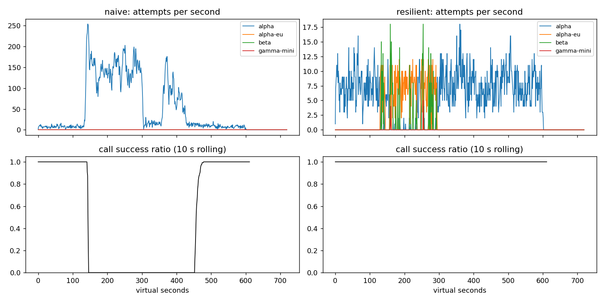

# Lab 25B — Report

**Họ tên / nhóm:** Đào Minh Hiếu — **MSV:** `2A202602561`  **Commit:** _chờ tạo commit nộp bài_  **Điểm tự động:** 84/88 điểm đã kiểm chứng công khai

> `make grade` đạt toàn bộ 84 điểm có thể chấm trong repo. Bốn điểm còn lại dùng bộ SLO ẩn của giảng viên. Các số dưới đây dùng seed 25; kiểm tra bổ sung với seed 25, 26, 27 đều PASS.

## 1. Kết quả Game Day (naive vs resilient)

| Băng | Client | availability | p95 (s) | amplification | retry_ratio | cost/turn | recovery (s) | PASS? |
|---|---|---:|---:|---:|---:|---:|---:|:---:|
| G1 | naive | 0,7194 | 7,157 | 7,738 | 6,738 | 2,163 | 4 | Không |
| G1 | resilient | 1,0000 | 4,780 | 1,063 | 0,001 | 2,104 | 0 | Có |
| G2 | naive | 0,4560 | 15,034 | 9,904 | 8,904 | 4,627 | 155 | Không |
| G2 | resilient | 1,0000 | 10,362 | 1,037 | 0,005 | 2,112 | 0 | Có |
| G3 | naive | 1,0000 | 4,768 | 1,164 | 0,164 | 2,328 | 0 | Không |
| G3 | resilient | 1,0000 | 4,621 | 1,058 | 0,030 | 2,140 | 0 | Có |
| G4 | naive | 1,0000 | 13,764 | 1,004 | 0,004 | 2,008 | 0 | Không |
| G4 | resilient | 1,0000 | 5,626 | 1,014 | 0,002 | 2,072 | 0 | Có |
| G5 | naive | 0,3699 | 5,359 | 17,030 | 16,030 | 2,124 | — | Không |
| G5 | resilient | 0,8179 | 5,477 | 1,003 | 0,002 | 2,504 | — | Có |
| G6 | naive | 0,5170 | 4,836 | 12,344 | 11,344 | 2,009 | 0 | Không |
| G6 | resilient | 1,0000 | 5,961 | 1,055 | 0,018 | 2,196 | 0 | Có |

## 2. Cấu hình client và lý do

| Tham số | Giá trị | Lý do có số liệu |
|---|---:|---|
| `attempt_timeout_s` | 8,0 s | Ngắn hơn deadline 30 s để còn thời gian failover. G6 đạt availability 1,000; thử 30 s chỉ còn 0,9488. |
| `max_attempts_per_provider` | 2 | Cho đúng một retry cùng provider. Amplification G2 chỉ 1,037 và G3 chỉ 1,058. |
| `backoff_base_s / cap_s` | 0,25 / 4,0 s | Full jitter phân tán retry; cùng cooldown dùng `retry-after`. G1 có 0 vi phạm và amplification 1,063. |
| `retry_budget_ratio` | 0,10 | Giới hạn retry gần 10% tải mới. Khi breaker bị vô hiệu hóa, G2 retry ratio là 0,058 thay vì 0,378 nếu tắt budget. |
| `retry_budget_min_per_s / max_tokens` | 0,5 / 20 | Vẫn cho phép một ít retry sau thời gian yên lặng nhưng chặn burst lớn; G3 retry ratio 0,030. |
| `breaker.window_size / min_calls` | 20 / 10 | Đủ nhạy để chuyển tải nhưng không trip vì vài lỗi nền; cả 6 băng PASS trên ba seed. |
| `breaker.failure_rate_threshold` | 0,50 | Trip khi lỗi chiếm đa số. G2 recovery giảm từ 155 s xuống 0 s. |
| `breaker.slow_call_s / slow_rate_threshold` | 5,0 s / 0,60 | Bắt brown-slow không có mã lỗi. G4 p95 giảm từ 13,764 s xuống 5,626 s. |
| `breaker.open_duration_s` | 10,0 s | Đủ để hàng đợi hạ nhiệt nhưng thử lại sớm; G2 và G6 đều recovery 0 s, traffic về primary đạt 1,000. |
| `half_open_max_probes / successes` | 2 / 2 | Chỉ hai probe đồng thời và cần cả hai tốt trước khi đóng breaker, tránh thundering herd. |
| `quota_cooldown_s` | 300 s | Không tiếp tục gọi account hết credit. G5 có 0 retry lỗi 400, 0 failover không cần thiết, availability 0,8179. |

Sơ đồ quyết định `on_error`:

| Loại lỗi | Breaker | Retry cùng provider | Failover/cooldown |
|---|---|---|---|
| `CLIENT_ERROR` | release permit, không ghi lỗi | Không | Không; `GiveUp(client_error)` |
| `QUOTA_EXHAUSTED` | release | Không | Failover ngay; cooldown 300 s |
| `RATE_LIMITED` | release | Không | Failover ngay; cooldown đúng `retry-after` |
| `OVERLOADED`, `SERVER_ERROR`, `TIMEOUT` | ghi failure | Chỉ khi còn attempt, còn budget và kịp deadline; full jitter | Hết điều kiện thì chuyển provider kế tiếp |

Mọi route đều lọc theo capability; `tool` chỉ đi qua `alpha`, `alpha-eu`, `beta`. Khi hết ladder, client chỉ chờ cooldown rate-limit tối đa 5 s nếu vẫn kịp deadline; cooldown quota và breaker OPEN không được chờ.

## 3. Ba thí nghiệm

1. **Retry budget là lớp phòng thủ cuối.** Khi cố ý vô hiệu breaker (`min_calls=1.000.000.000`) và cho 5 attempt/provider, bật budget giúp G2 có amplification 1,378, retry ratio 0,058, availability 0,9983 và recovery 0 s; tắt budget làm các số thành 1,580, 0,378, 0,9754 và 24 s. Ở G3, budget hạ retry ratio từ 0,158 xuống 0,068 và amplification từ 1,162 xuống 1,136. Khi breaker đúng, lợi ích nhìn thấy nhỏ hơn vì breaker đã chuyển tải sớm, nhưng budget vẫn là giới hạn tải độc lập nếu breaker cấu hình sai, chưa đủ mẫu hoặc lỗi phân tán dưới ngưỡng trip.

2. **Timeout 30 s.** Đọc availability và nguyên nhân bỏ cuộc trước: so với cấu hình 8 s, G6 giảm availability từ 1,0000 xuống 0,9488; `give_up_reasons` từ `{}` thành `{"deadline": 107, "no_provider_available": 15}` vì request treo ở `alpha-eu` chiếm gần hết deadline, không còn thời gian failover. P95 của các lượt *thành công* lại giảm từ 5,961 xuống 5,440 s — đây là survivor bias vì 122 lượt bỏ cuộc không nằm trong phân vị. G4 là đối chứng: availability vẫn 1,0000, `give_up_reasons={}` và p95 gần như không đổi (5,626 so với 5,608 s), do slow-call breaker ở 5 s phát hiện suy giảm mà không cần timeout; timeout đúng phải dựa trên latency histogram của từng deployment, deadline end-to-end và thời gian cần chừa cho fallback.

3. **Bỏ lọc tool calling.** Trên G6, `incompatible_routes` tăng từ 0 lên 257 và availability giảm từ 1,0000 xuống 0,8922. Nói theo ngôn ngữ sản phẩm: 257 lượt đã được gửi tới model rẻ nhưng không có chức năng bắt buộc, nên dù model trả lời, kết quả không thể hoàn thành tác vụ của khách hàng. Đây là lỗi tương thích sản phẩm, không phải lỗi hạ tầng có thể chữa bằng retry.

Số đầy đủ và cách tái tạo nằm trong `reports/experiments.json` và `scripts/run_report_experiments.py`.

## 4. Workflow hoàn tiền

| Executor | completion | crashes | duplicate refunds | duplicate emails | lost refunds | overpaid | wasted LLM / crash |
|---|---:|---:|---:|---:|---:|---:|---:|
| naive | 1,000 | 81 | 128 | 81 | 0 | 1.574.200 cent | 1,123 |
| resilient | 1,000 | 66 | 0 | 0 | 0 | 0 | 0,303 |

Idempotency key ngăn payment/e-mail thực thi lần hai khi response mất hoặc worker restart, nhưng một mình nó không tránh chạy lại các bước LLM/read-only tốn tiền. Checkpoint giúp worker mới resume mà không tính lại, nhưng một mình checkpoint không đóng được khoảng trống giữa side effect đã commit và worker crash trước khi ghi checkpoint. Ghi checkpoint *trước* payment còn nguy hiểm hơn: crash hoặc lỗi trước khi payment chạy sẽ khiến worker mới tưởng bước đã xong, tạo lost refund. Vì vậy thứ tự đúng là gọi side effect với key ổn định, nhận kết quả, rồi checkpoint kết quả.

## 5. Alerting và error budget

| Sự cố | Mong đợi | Naive alerter | Burn-rate alerter | Độ trễ burn-rate |
|---|---|---|---|---:|
| `checkout_bug` | page | page +1 phút | page | 27 phút |
| `provider_outage` | page | page +0 phút | page | 4 phút |
| `deploy_blip` | none | false page | không alert | — |
| `slow_leak` | ticket | bỏ sót | ticket | 1.337 phút |
| `degraded_evening` | page | page +214 phút | page | 291 phút |
| `night_spike` | none | false page | không alert | — |
| `small_bump` | none | false page | không alert | — |

Trong 25.901.755 request có 55.618 bad; availability là 99,7853%. Error budget cho SLO 99,5% là 129.508,8 bad request: đã tiêu 42,95%, còn 57,05%, nên chưa freeze release. `small_bump` chỉ kéo dài 20 phút: cửa sổ ngắn có burn cao nhưng cửa sổ dài không đồng thời vượt ngưỡng, nên không đủ tín hiệu về mức tiêu budget bền vững để đánh thức on-call lúc 11 giờ trưa.

## 6. Postmortem — G2 với client naive (blameless)

**Tóm tắt.** `alpha` mất 75% GPU từ t=120 đến t=300, nhưng retry ba tầng của client nâng amplification lên 9,904× và biến suy giảm hữu hạn thành failure metastable. Trong 2.362 lượt có 1.285 lượt thất bại; availability chỉ 45,60%. Provider hồi phục ở t=300 nhưng hệ thống cần thêm 155 s mới đạt cửa sổ 30 s có success ≥95%.

**Ảnh hưởng.** Có 1.285/2.362 lượt user thất bại; ảnh hưởng từ lúc mất GPU đến mốc recovery kéo dài khoảng 335 s, dài hơn sự cố provider 155 s. Với tải danh nghĩa 4 lượt/s trong 30 ngày, budget SLO 99,5% là 51.840 lượt lỗi; sự cố này tiêu 2,48% budget tháng. Nếu chỉ nhìn cửa sổ tape 10 phút, budget cho phép 11,8 lượt lỗi nhưng thực tế có 1.285, tức 108,8 lần budget của chính cửa sổ đó.

Các số dưới đây là cửa sổ 10 giây bắt đầu tại `t`; success là `calls_ok/calls_done`. Mốc recovery dùng thêm cửa sổ 30 giây theo định nghĩa của simulator.

| t | Sự kiện | Bằng chứng |
|---:|---|---|
| 110 | Trạng thái bình thường trước sự cố | 9,1 attempts/s; success 100% |
| 120 | `alpha` mất 75% năng lực | 6,2 attempts/s; success còn 100% do hàng đợi che độ trễ ban đầu |
| 130 | Retry bắt đầu khuếch đại hàng đợi | 51,9 attempts/s; success 100% nhưng request đang dồn tích |
| 180 | Hệ thống rơi vào failure hoàn toàn | 148,1 attempts/s; success 0% |
| 290 | Cuối thời gian mất GPU | 146,1 attempts/s; success 0% |
| 300 | GPU hồi phục hoàn toàn | vẫn 38,8 attempts/s; success 0% |
| 360 | Failure metastable tiếp tục | 110,8 attempts/s; success 0% dù provider đã khỏe 60 s |
| 455 | Bắt đầu đạt tiêu chí recovery | 13,0 attempts/s; success 10 s là 85,7%, cửa sổ 30 s là 95,7% |
| 470 | Hàng đợi và retry cũ đã thoát | 8,9 attempts/s; success 100% |

**Trigger và root cause.** Trigger là provider mất 75% GPU trong 180 s. Root cause nằm ở thiết kế hệ thống: app, gateway và SDK cùng retry, delay cố định, không jitter, không retry budget, không breaker và không fallback. Khi request timeout, server vẫn xử lý request cũ; client lại gửi bản sao, làm offered load vượt capacity và queue chứa nhiều việc mà user đã bỏ. Sau t=300, retry mới cộng với backlog cũ vẫn giữ tải cao, tiếp tục gây timeout/529/rate-limit rồi sinh thêm retry — vòng phản hồi tự duy trì khiến hệ thống không tự hồi phục ngay.

**Điều gì giúp / làm tệ hơn.** Việc traffic đầu vào không tăng và hàng đợi cuối cùng thoát giúp hệ thống hồi phục ở t=455. Timeout phía client không hủy công việc server, retry đồng bộ cố định và 36 attempt/call làm tình hình tệ hơn; không có cơ chế nào ở naive chủ động giảm tải. Bản resilient dùng một tầng retry có jitter/budget, breaker và fallback nên G2 đạt availability 100%, amplification 1,037 và recovery 0 s.

| # | Hành động | Loại | Owner | Cách kiểm chứng |
|---:|---|---|---|---|
| 1 | Chuẩn hóa chỉ một tầng retry với full jitter và budget 10% | prevent | Agent Platform | CI chạy G2 đa seed: amplification ≤1,6 và retry ratio theo budget |
| 2 | Triển khai sliding-window breaker có slow-call và probe HALF_OPEN giới hạn | mitigate | LLM Gateway | Fault injection mất 75% capacity: recovery ≤30 s, primary share sau restore ≥0,8 |
| 3 | Dashboard và alert cho amplification, queue wait, timeout và recovery lag | detect | SRE | Cảnh báo thử nghiệm phát trong 5 phút khi amplification >1,6 hoặc success 30 s <95% |
| 4 | Truyền cancellation/deadline xuống provider khi có hỗ trợ | mitigate | Provider Integration | Load test xác nhận request client đã bỏ không tiếp tục chiếm slot quá deadline |

## 7. Một điểm yếu còn lại

G2 dù PASS vẫn có p95 10,362 s, cao hơn các băng khác, và failover sang `beta` có giá 1,4 lần. Nếu cả bốn deployment cùng chậm nhưng chưa vượt ngưỡng lỗi, các breaker độc lập có thể cùng mở/đóng và tạo tail latency cao. Bước tiếp theo là timeout thích nghi theo latency percentile từng provider, giới hạn concurrency/bulkhead theo deployment và routing có trọng số theo latency, cost, capacity; vẫn phải giữ capability constraint và đo bằng một tape “all providers slow”.

## 8. Cache

| Client | availability | faq_availability | cache_hit_ratio | stale_served | wrong_answers | outdated_answers | cost/turn | PASS? |
|---|---:|---:|---:|---:|---:|---:|---:|:---:|
| resilient, không cache | 0,8373 | 0,8424 | 0,000 | 0 | 0 | 0 | 1,386 | Không |
| cached | 0,9124 | 0,9645 | 0,652 | 157 | 0 | 3 | 0,915 | Có |

| Tham số `cache:` | Giá trị | Lý do có số liệu |
|---|---:|---|
| `similarity_threshold` | 0,90 | 0,80 tạo 157 `other_question`; 0,90 giữ wrong=0 và hit 0,652; 0,97 cũng đúng nhưng hit giảm còn 0,581. |
| `ttl_s` | 60 s | TTL 300 tạo 95 outdated; 60 chỉ có 3 và hit 0,652. TTL 30 giảm outdated còn 2 nhưng hit còn 0,592 và cost tăng từ 0,915 lên 0,955. |
| `max_stale_s` | 600 s | Bao trọn outage 120 s: phục vụ 157 stale và FAQ availability 0,9645. Đặt 0 làm FAQ availability giảm còn 0,8733. |
| `max_entries` | 500 | Lớn hơn tập FAQ hoạt động nhưng vẫn chặn tăng bộ nhớ vô hạn; eviction dùng LRU. |

1. **Ngưỡng similarity.** Ở 0,80 / 0,90 / 0,97, hit ratio lần lượt là 0,666 / 0,652 / 0,581; wrong answers là 157 / 0 / 0; cost/good turn là 0,965 / 0,915 / 0,964. Toàn bộ 157 lỗi tại 0,80 là `other_question`: các cặp gần nhưng khác ý như chính sách hoàn tiền/thời gian hoàn, đổi size/đổi màu, phí ship nội thành/đi tỉnh bị nhập chung. 0,90 là điểm cân bằng an toàn và hiệu quả.

2. **TTL.** Với TTL 30 / 60 / 300 s, outdated answers là 2 / 3 / 95 và hit ratio là 0,592 / 0,652 / 0,731. Webhook chỉ giúp tài liệu `policy/refund` đã công bố thay đổi; cập nhật `policy/shipping` là silent nên client không có sự kiện để invalidate. TTL là giới hạn duy nhất cho thời gian câu trả lời shipping cũ còn được coi fresh; chọn 60 s giữ outdated dưới 15 mà không hy sinh quá nhiều hit.

3. **Stale-if-error.** Với `max_stale_s=0`, FAQ availability giảm từ 0,9645 xuống 0,8733, hit ratio từ 0,652 xuống 0,561 và stale served từ 157 xuống 0. Cửa sổ 600 s cho phép dùng câu trả lời đã quá TTL khi mọi provider bỏ cuộc nhưng vẫn tuân thủ prompt scope và invalidation.

Câu hỏi cá nhân không cache kể cả chia namespace theo user: trạng thái đơn/refund/điểm thay đổi nhanh, không phải mọi thay đổi đều có webhook, và cache tăng bề mặt rò rỉ do lỗi khóa/tenant trong khi lợi ích hit thấp. Trong outage, dashboard không được chỉ nhìn user availability vì stale có thể che sự cố. Cần alert trên direct-provider canary, tỷ lệ provider error/`GiveUp`, breaker OPEN, `stale_served` rate và tuổi của stale answer; ví dụ page khi canary thất bại đồng thời stale rate tăng liên tục 5 phút.
